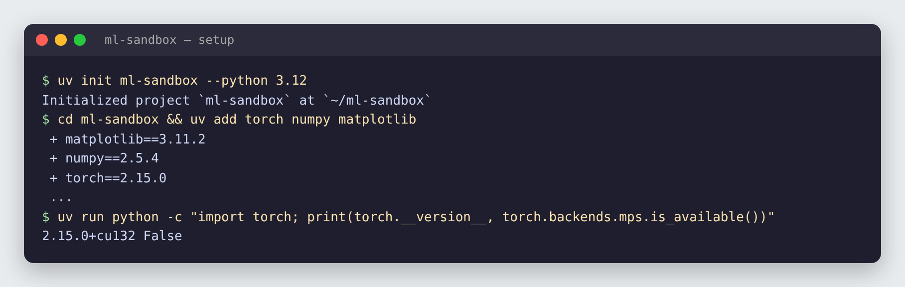
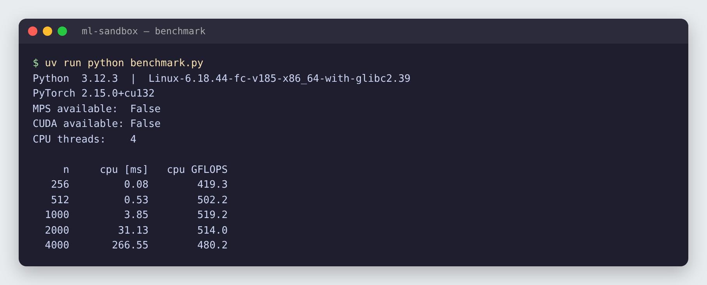
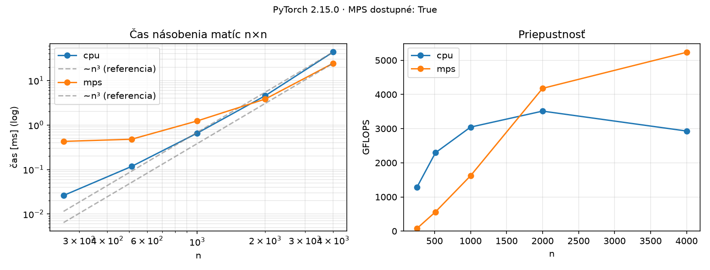

# 01 · Setup & matmul benchmark

🇸🇰 [Slovenská verzia](README.sk.md) · 📘 [Step-by-step tutorial](TUTORIAL.md)

## TL;DR
A reproducible Python ML environment managed with `uv`, plus a benchmark that detects available devices (CPU, Apple MPS, NVIDIA CUDA) and times matrix multiplication on them. The saved results come from an Apple Silicon Mac and include CPU and MPS. Larger matrices require approximately **O(n³)** work.

## Start here
A matrix is a table of numbers. Neural networks multiply such tables constantly, for example when processing inputs or comparing words in a sentence. This task picks one basic calculation and asks two questions: **can I recreate the project on another computer, and how quickly can my processor or graphics hardware perform the calculation?**

The script creates pairs of square matrices at several sizes, multiplies each pair on available devices, and measures the time. It produces a terminal table, `results.json`, and a plot. **Lower time means a faster calculation; higher GFLOPS means more work completed per second.** It repeats measurements, leaves out the first run, and waits for GPU work to finish before stopping the clock.

This prepares the later ML projects and demonstrates careful measurement. It does not train a model: the speed of one matrix multiplication does not by itself tell us the speed of an entire neural network.

## Problem
Every later project in this repo (autograd, GPT from scratch, LoRA fine-tuning, RAG) depends on two things:
1. an environment that installs the same way on any machine, and
2. knowing whether PyTorch can compute on an available GPU and how its runtime compares with the CPU.

Matrix multiplication is the right thing to measure: a linear layer, attention (`Q @ Kᵀ`, `scores @ V`) and an MLP block are all matmuls, and they take most of the compute in a neural network.

## Setup


```bash
uv init ml-sandbox --python 3.12
cd ml-sandbox
uv add torch numpy matplotlib
uv run python -c "import torch; print(torch.__version__, torch.backends.mps.is_available())"
```

What each piece does:

| Tool / file | Role |
|---|---|
| `uv` | Installs Python itself and the packages, creates `.venv/` for this project only. Much faster than pip. |
| `.python-version` | Pins Python 3.12 for this project. |
| `pyproject.toml` | Lists the direct dependencies (`torch`, `numpy`, `matplotlib`). |
| `uv.lock` | Pins the exact version of **every** package, including transitive ones. `uv sync` on another machine recreates the identical environment. |
| `uv run …` | Runs a command inside the project's `.venv` without activating it manually. |

## How it works

### 1. Detecting devices
```python
devices = ["cpu"]
if torch.backends.mps.is_available():   # Apple Silicon GPU (Metal Performance Shaders)
    devices.append("mps")
if torch.cuda.is_available():           # NVIDIA GPU
    devices.append("cuda")
```
PyTorch puts every tensor on a *device*. The same code runs anywhere: you only change `device=`. On a Mac, MPS is the GPU backend; CUDA is the NVIDIA one used on Colab/Kaggle.

### 2. Timing one matrix multiplication
```python
a = torch.randn(n, n, device=device)
b = torch.randn(n, n, device=device)
a @ b                 # warm-up
sync(device)
for _ in range(repeats):
    start = time.perf_counter()
    a @ b
    sync(device)
    times.append(time.perf_counter() - start)
return median(times)
```
Three measurement pitfalls the code avoids:

- **Warm-up.** The first call allocates memory and prepares GPU kernels. It is always slower and would distort the result, so it is run once and not timed.
- **Synchronization.** On a GPU, `a @ b` returns immediately and the work runs asynchronously in the background. Without `torch.mps.synchronize()` (or `torch.cuda.synchronize()`) the timer would only measure how long it took to *queue* the work, and the GPU would look impossibly fast. On CPU, `sync` does nothing because the CPU computes synchronously.
- **Median of 5 runs.** Single measurements are noisy (other processes, CPU frequency changes). The median ignores outliers better than the mean.

### 3. From time to GFLOPS
```python
gflops = 2 * n**3 / t / 1e9
```
Each of the n² output cells is a dot product of length n: n multiplications and n additions. That gives n² · 2n = **2n³** floating-point operations (FLOPs). Dividing by the time gives FLOPs per second; `1e9` turns that into GFLOPS. This makes different matrix sizes and different devices directly comparable.

### 4. Outputs
- `benchmark.py` prints the table and saves the raw numbers to `results.json`.
- `plot.py` reads `results.json` and draws `assets/matmul_benchmark.png`. Separating measurement and plotting means you can restyle a chart without rerunning the benchmark.

```
benchmark.py ──► results.json ──► plot.py ──► assets/matmul_benchmark.png
      └──► table in the terminal
```

## Results


*Historical output from a Linux CPU. The current table and plot below come from `results.json` measured on a Mac with CPU and MPS.*

| n | CPU time [ms] | CPU GFLOPS | MPS time [ms] | MPS GFLOPS |
|---:|---:|---:|---:|---:|
| 256 | 0.03 | 1,286 | 0.43 | 78 |
| 512 | 0.12 | 2,293 | 0.48 | 561 |
| 1000 | 0.66 | 3,044 | 1.23 | 1,620 |
| 2000 | 4.56 | 3,512 | 3.83 | 4,178 |
| 4000 | 43.70 | 2,929 | 24.46 | 5,233 |



**How to read the plots**
- **Left:** runtime grows with matrix size; the dashed line shows the theoretical `n³` trend. Doubling the side length means roughly eight times as many basic operations, although overhead and memory also affect measured time.
- **Right:** GFLOPS means billions of operations per second. MPS is slower than CPU for a small matrix because preparing GPU work takes a large share of the time; parallel computation pays off for larger matrices. This ranking applies to the measured Mac, not every computer.

**Why this matters later:** attention compares every token with every other token, so its cost grows with the square of the context length. Model size and context length multiply the cost, which is why KV cache, quantization and batching (projects P4 and P10) exist.

## 🏎️ On the cars

200 cars, each with its own small neural network brain. Computing all brains in **one batched matmul** instead of a Python loop over cars gives the same steering **21× faster** (0.73 ms → 0.034 ms for 200 cars). Same lesson as this step: batch the work, then measure it.


Full chapter: [Racing Lab · ch. 01](https://github.com/kavicka/05-racing-lab/blob/main/README.md#ch-01--batching-200-brains-in-one-matmul) · code: [`chapters/ch01_batch.py`](https://github.com/kavicka/05-racing-lab/blob/main/chapters/ch01_batch.py)

## What I learned
- `uv` + a lockfile make every project reproducible with one command.
- How to detect accelerators in PyTorch and move tensors between devices.
- How to time GPU code correctly: warm-up, synchronize, median.
- Matrix multiplication is O(n³), and GFLOPS normalizes speed so devices can be compared.

## Run it
```bash
uv sync                      # create .venv from uv.lock
uv run python benchmark.py   # print the table, write results.json
uv run python plot.py        # write assets/matmul_benchmark.png
```

## Limitations
- The published numbers come from one Apple Silicon Mac; other hardware may produce different results.
- float32 only; float16/bfloat16 would be faster on GPUs.
- One operation (square matmul) is not a full training benchmark.
